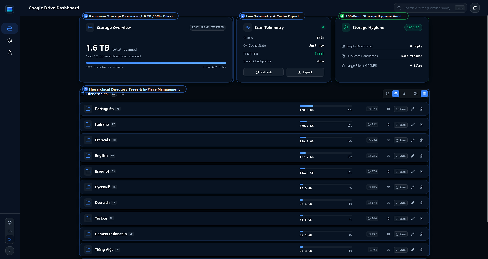
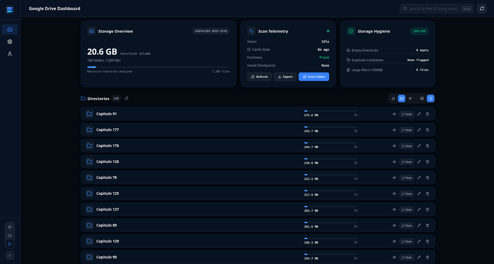
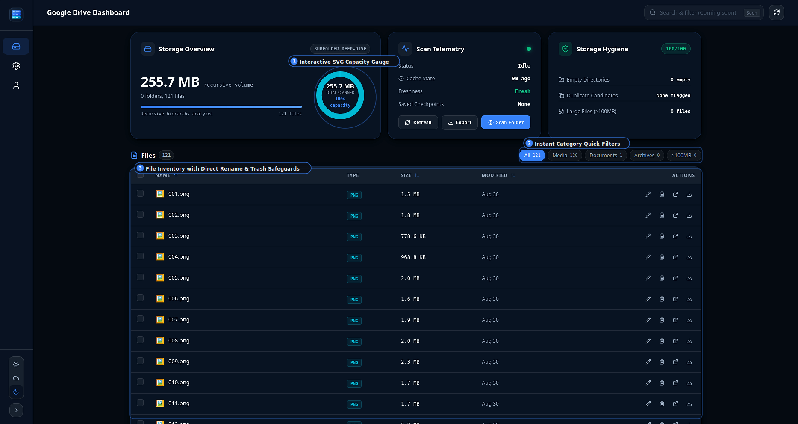
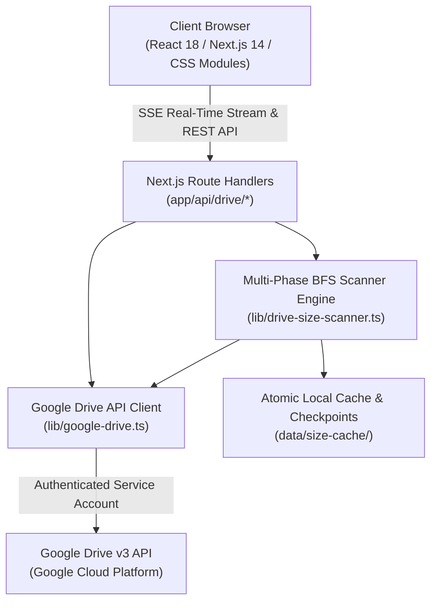

# Google Drive Dashboard

<div align="center">

[](https://nextjs.org/)
[](https://www.typescriptlang.org/)
[](LICENSE)
[](https://nodejs.org/)
[](https://github.com/HassanBDS/google-drive-dashboard/pulls)

<br />

**A fast, visual disk usage analyzer and storage hygiene manager for Google Drive.**  
Analyze recursive folder volume, navigate multi-terabyte libraries with parallel BFS scanning, and leverage local caching without Google Drive's native uncalculated folder sizes.

[Overview](#overview) • [Why This Exists](#why-this-exists-google-drive-vs-dashboard) • [Key Features](#key-features) • [Visual Showcase](#visual-showcase) • [Quick Start](#quick-start-guide-5-minutes) • [Architecture](#architecture--technical-design) • [Privacy & Security](#privacy--security-guarantee) • [License](#license)

<br />



</div>

---

## 🔒 Privacy & Security Guarantee

> [!IMPORTANT]
> **Your credentials, tokens, and files remain strictly on your local machine.**

- **100% Self-Hosted & Local**: Runs entirely on your personal computer (`http://localhost:3000`).
- **Zero Third-Party Telemetry**: No external backend servers, tracking scripts, analytics, or remote logging.
- **Direct Google API Connection**: Traffic travels exclusively between your local server and official Google endpoints (`https://www.googleapis.com/drive/v3/*`).
- **Strictly Isolated Keys**: Your Service Account JSON key (`secrets/service-account.json`) and environment settings (`.env.local`) are permanently ignored in `.gitignore`. They are never sent to the browser bundle, never uploaded, and never shared.
- **Zero Creator Access**: The author of this project has no access to your Google Drive account, credentials, or files.

---

## Why This Exists: Google Drive vs. Dashboard

Native Google Drive does not calculate recursive folder sizes, making it difficult to pinpoint where storage quota is consumed.

| Capability | Native Google Drive Web UI | Google Drive Dashboard |
|:---|:---:|:---:|
| **Folder Size Calculation** | Not supported (shows `--`) | Full recursive calculation (exact B, KB, MB, GB, TB) |
| **Deep Directory Scanning** | Frequently freezes or times out on large trees | Multi-phase BFS parallel queue (scales to 5M+ files) |
| **Scan Persistence** | None (progress lost on page reload) | Auto-saves checkpoints every 30 folders; pause & resume |
| **Storage Hygiene Scoring** | None (requires manual directory traversal) | Automated 100-point audit (detects empty & duplicate folders) |
| **File Classification** | Basic text search filters only | Interactive capacity gauge & category filters (Media, Docs, Archives, >100MB) |
| **Browsing Latency** | Cloud re-fetch per click | Instant local caching with subfolder deep-dive navigation |
| **Cache Data Portability** | None | One-click consolidated JSON cache export |
| **Data Privacy** | Cloud hosted | Local self-hosted runtime; zero telemetry |

---

## Key Features

- **Multi-Phase BFS Scanner**: Discovers directory hierarchies level-by-level before computing weights, delivering immediate progress feedback and handling libraries exceeding 2 TB without connection timeouts.
- **Resumable Scan Checkpoints**: Scans automatically save checkpoints to local disk every 30 folders. Pause, stop, and resume scans without losing progress or exhausting Google Cloud API quotas.
- **Storage Overview Telemetry**: High-level metrics displaying total scanned volume, top-level directory distribution, scan freshness, and active file counts.
- **Storage Hygiene Audit**: Identifies storage waste automatically by detecting empty directories, candidate duplicate folder names, and oversized files (>100MB).
- **Subfolder Deep-Dive Analysis**: Navigate complex subfolder hierarchies with responsive breadcrumb navigation and recursive volume breakdown per branch.
- **File Explorer with Quick Filters**: Inspect individual files inside directories, switch between All, Media, Documents, Archives, or Large Files (>100MB), and view capacity distribution via an interactive SVG donut gauge.
- **In-Place File Operations**: Rename directories and files with collision prevention, or move items to trash with confirmation safeguards.
- **Offline Cache Export**: Download a consolidated JSON snapshot of precomputed directory weights for offline review or backup.
- **Adaptive Theme Engine**: Curated dark, dim, and light themes with smooth CSS micro-interactions.

---

## Visual Showcase

### 1. Main Dashboard Overview
Comprehensive telemetry showing recursive storage volume, scan freshness, 100-point hygiene scoring, and top-level directory volume breakdown.

<div align="center">
  
</div>

<br />

### 2. Subfolder Deep-Dive
Drill down into nested directory branches. Each folder shows its recursive weight, file count, and percentage share of its parent container.

<div align="center">
  
</div>

<br />

### 3. File Explorer with Capacity Gauge & Category Filters
Examine files in any folder, filter instantaneously by category, and evaluate storage distribution with an interactive SVG donut gauge.

<div align="center">
  
</div>

---

## Quick Start Guide (5 Minutes)

### Step 1: Install Node.js
If Node.js is not already installed on your system, download the **LTS (Long Term Support)** installer:
- **[Download Node.js (Windows, macOS, Linux)](https://nodejs.org/)**

---

### Step 2: Download the Project
1. Download this repository as a ZIP (click **Code → Download ZIP** on GitHub) or clone it:
   ```bash
   git clone https://github.com/HassanBDS/Google_Drive_Dashboard.git
   cd Google_Drive_Dashboard
   ```

---

### Step 3: Start the Application
Run the following commands in your terminal:

```bash
# Install dependencies
npm install

# Start local server
npm run dev
```

Open **[http://localhost:3000](http://localhost:3000)** in your browser.

---

### Step 4: Configure Google Drive Credentials
Navigate to **[http://localhost:3000/settings](http://localhost:3000/settings)** to use the built-in Setup Wizard:

1. **Enable Google Drive API**:
   - Open `console.cloud.google.com` (free account).
   - Navigate to **APIs & Services → Enable APIs and Services**, search for **Google Drive API**, and click **Enable**.
2. **Create a Service Account & Download Key**:
   - Go to **APIs & Services → Credentials → Create Credentials → Service Account**.
   - Assign a name (e.g. `drive-dashboard`) and click **Done**.
   - Select the created service account, navigate to the **Keys** tab, click **Add Key → Create new key → JSON**, and save the file.
3. **Share Your Google Drive Folder**:
   - In `drive.google.com`, right-click the folder you wish to analyze, select **Share**, and paste the service account email (`...iam.gserviceaccount.com`).
   - Assign the **Viewer** role (or **Editor** if you plan to use in-place rename/trash actions).
4. **Save in Dashboard**:
   - In the dashboard at `http://localhost:3000/settings`, upload your JSON key and input your Google Drive folder link or ID.
   - Click **Save & Verify**.

---

## Advanced & Developer Setup

### Environment Variables (`.env.local`)
Developers can bypass the web wizard by configuring environment variables directly:

```bash
cp .env.example .env.local
```

Edit `.env.local`:
```env
# Path to your Service Account JSON key
GDRIVE_CREDENTIALS_PATH=./secrets/service-account.json

# ID of your target Google Drive root folder
GDRIVE_ROOT_FOLDER_ID=your_google_drive_folder_id_here

# Optional label displayed in header
GDRIVE_DRIVE_NAME="Primary Drive"
```

### Available Scripts

| Command | Description |
|---|---|
| `npm run dev` | Starts local Next.js development server at `http://localhost:3000`. |
| `npm run build` | Compiles optimized production bundle. |
| `npm run start` | Serves compiled production build locally. |
| `npm run lint` | Runs ESLint validation across all sources. |
| `npx tsc --noEmit` | Performs TypeScript compiler verification. |

---

## Architecture & Technical Design



### 1. Multi-Phase BFS Parallel Scanner (`lib/drive-size-scanner.ts`)
To prevent HTTP timeouts when processing large libraries, the scanner separates discovery from calculation:
- **Phase 1: Breadth-First Directory Discovery**: Explores the tree level-by-level using parallel BFS queue workers, populating structural metadata immediately.
- **Phase 2: Bottom-Up Recursive Sizing**: Accumulates file weights upward from leaf nodes to root directories.

### 2. Checkpointing & Recovery
- Every 30 processed folders, the engine atomically updates `data/size-cache/checkpoint.json`.
- Interrupted or stopped scans resume from the latest saved checkpoint, preventing duplicate API requests and quota waste.

### 3. Orphaned Cache Reconciliation
- When directories are deleted or relocated directly inside Google Drive, the reconciliation cycle identifies orphan entries and purges outdated cache files automatically.

### 4. Zero Client Leaks
- All Google Drive API communication is executed on the local Node.js server.
- Private keys and OAuth tokens are never exposed to client-side bundles.

---

## Cross-Platform Compatibility

Tested across all major operating systems:

- **Linux** (Ubuntu, Debian, Fedora, Arch): Uses IPv4 DNS socket prioritization in `next.config.mjs` to eliminate DNS resolution timeouts on Linux distributions.
- **macOS** (Apple Silicon M1/M2/M3 & Intel): Full native performance.
- **Windows** (PowerShell, Command Prompt, WSL2): Normalized path handling using `node:path`.

---

## Creator & Support

Created and maintained by **Hassan BDS** ([@HassanBDS](https://github.com/HassanBDS)).

<div align="center">

[](https://paypal.me/hassanoukassi89hbd)
[](https://github.com/HassanBDS)

**Star this repository on GitHub**
If this tool saved you storage quota or time, consider starring ⭐ the repository on GitHub.

</div>

---

## License

This project is licensed under the [MIT License](LICENSE).
