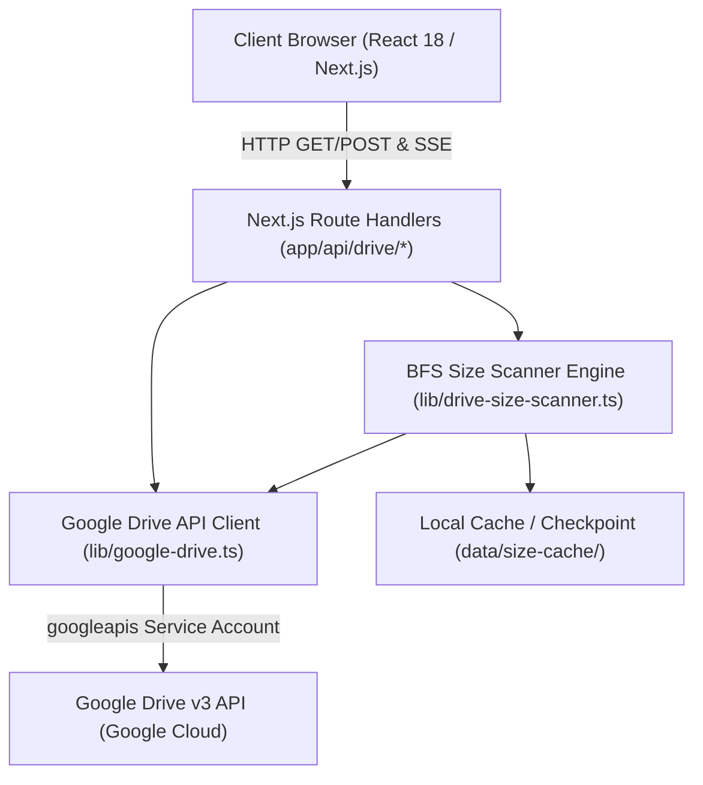

# 📁 Google Drive Dashboard

A fast, visual disk usage analyzer and file manager for Google Drive. Built with **Next.js 14**, **TypeScript**, and the **Google Drive v3 API**, featuring a high-performance **multi-phase Breadth-First Search (BFS) size scanner** with resumable checkpoints.

---

## ✨ Features

- 🗂️ **Interactive Tree Browser** — Navigate deep Google Drive folder hierarchies with instant breadcrumbs.
- ⚡ **Multi-Phase BFS Size Scanner** — Discovers folders level-by-level first to display immediate progress before calculating weights, handling 100GB–2TB+ libraries without timing out.
- 💾 **Resumable Checkpoints** — Auto-saves scan state every 30 folders to disk. Pause, stop, and resume heavy scans anytime without losing progress or exhausting Google API quotas.
- 📊 **Dynamic Storage Metrics** — Responsive metrics chips adapting by depth (Root folders, subfolder count, recursive sizes).
- 🏷️ **Duplicate & Health Warnings** — Automatically flags empty folders, missing media, and duplicate folder names.
- ✏️ **In-Place File Operations** — Rename folders and files directly with sibling collision protection, or move files to trash safely.
- 🔍 **Real-Time Search & Sorting** — Filter files and folders on the fly; sort by name (A-Z/Z-A), size (largest first), or item count.
- 🎨 **Adaptive Themes** — Sleek dark, dim, and light themes with smooth CSS micro-animations.
- 🔒 **Zero Client Leaks** — Service account keys remain strictly on your local backend server and are never sent to the browser.

---

## 🛠️ Architecture & Tech Stack



| Layer | Technology |
|---|---|
| **Framework** | Next.js 14 (App Router) |
| **Language** | TypeScript 5 |
| **Google API** | Google Drive API v3 (`googleapis`) |
| **Real-Time Streaming** | Server-Sent Events (SSE) via Web Streams API |
| **Styling** | Vanilla CSS Modules with CSS custom properties |
| **Icons** | Lucide React |

---

## 🚀 Getting Started

### 1. Prerequisites
- **Node.js**: v18.17.0 or higher ([Download](https://nodejs.org/))
- **Package Manager**: `yarn` or `npm`
- **Google Cloud Account**: A free Google Cloud project with Google Drive API enabled.

---

### 2. Google Cloud Setup (5 Minutes)

1. Go to the [Google Cloud Console](https://console.cloud.google.com/).
2. Create a new project (e.g., `my-drive-dashboard`).
3. In the sidebar, navigate to **APIs & Services > Library**.
4. Search for **Google Drive API** and click **Enable**.
5. Go to **APIs & Services > Credentials** and click **Create Credentials > Service Account**.
6. Give your service account a name and click **Create and Continue**.
7. Once created, click on the service account, navigate to the **Keys** tab, click **Add Key > Create new key**, choose **JSON**, and download the file.
8. **Share your Google Drive folder**:
   - Open [Google Drive](https://drive.google.com/).
   - Right-click the folder you want to browse and click **Share**.
   - Paste the service account's email address (found in your JSON file as `client_email`, e.g., `my-sa@my-project.iam.gserviceaccount.com`).
   - Grant it **Viewer** (for browsing and scanning) or **Editor** (if you want to rename or delete items).
   - Copy the folder ID from the URL (the string after `folders/` in `https://drive.google.com/drive/folders/YOUR_FOLDER_ID_HERE`).

---

### 3. Installation & Run

```bash
# 1. Clone repository
git clone https://github.com/HassanBDS/Google_Drive_Dashboard.git
cd Google_Drive_Dashboard

# 2. Install dependencies
yarn install
# or: npm install

# 3. Configure environment
cp .env.example .env.local

# 4. Place your downloaded Service Account JSON in the secrets/ folder
cp /path/to/your-key.json secrets/service-account.json

# 5. Open .env.local and update:
# GDRIVE_CREDENTIALS_PATH=./secrets/service-account.json
# GDRIVE_ROOT_FOLDER_ID=your_copied_folder_id_here
# GDRIVE_DRIVE_NAME="My Drive"

# 6. Start the local server
yarn dev
# or: npm run dev
```

Open [http://localhost:3000](http://localhost:3000) in your browser.

---

## 💻 Cross-Platform Compatibility

The dashboard is designed and tested to run seamlessly across all operating systems:

- **Linux** (Ubuntu, Debian, Fedora, Arch): Native IPv4 priority configured in `next.config.mjs` to prevent DNS socket timeouts on Linux distributions.
- **macOS** (Apple Silicon / Intel): Native Node.js support.
- **Windows** (Command Prompt, PowerShell, WSL2): Standard path normalization using `node:path`.

---

## 🔒 Security

- ⛔ **Private Keys**: All Service Account JSON keys are strictly git-ignored via `.gitignore`.
- ⛔ **Credentials Isolation**: The Google Drive API client is purely server-side (`lib/google-drive.ts`). Keys and tokens are never bundled into client JavaScript.
- ⛔ **Local Environment**: `.env.local` is git-ignored and never committed to version control.

---

## 📄 License

This project is open-source and available under the [MIT License](LICENSE).
